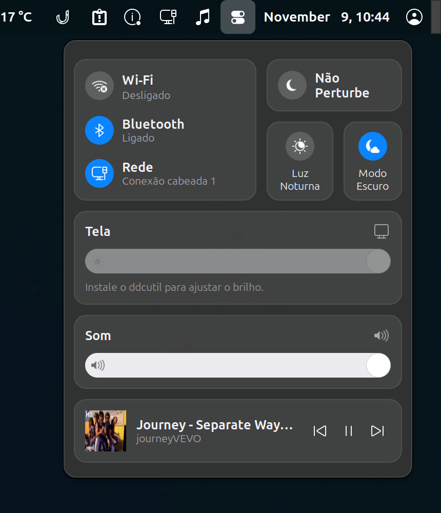

# Central de Controle para Cinnamon

Applet para o painel do **Linux Mint / Cinnamon** inspirado no Control Center do macOS Big Sur.



## Recursos

- **Wi‑Fi** – liga/desliga o rádio e mostra a rede conectada
- **Bluetooth** – liga/desliga o adaptador e mostra os dispositivos conectados (BlueZ via D‑Bus)
- **Rede** – status da conexão cabeada/primária (NetworkManager)
- **Baterias** – anéis com a carga do mouse e do fone sem fio (passe o mouse para ver a %)
- **Luz Noturna** – ativa na hora, mesmo fora do horário agendado
- **Modo Escuro** – alterna tema GTK, ícones e tema do Cinnamon entre as variantes *Dark* e *Light* (ex.: WhiteSur)
- **Tela** – brilho do monitor externo via DDC/CI (`ddcutil`); clicando no título, troca a taxa de atualização (60/120/240 Hz…) e a escala (100%–200%) de cada monitor
- **Som** – volume da saída padrão (PulseAudio/PipeWire), com rolagem do mouse; clicando no título, escolhe a saída de áudio
- **Tocando agora** – capa, título e controles de qualquer player MPRIS (Spotify, YouTube no navegador, VLC…); clicar na música traz o player para a frente

O visual segue automaticamente o tema claro/escuro.

### Tamanho

Arraste a alça no **canto inferior esquerdo** da Central para deixá-la maior ou menor (70%–160%);
duplo clique na alça volta a 100%. O tamanho fica salvo e também pode ser ajustado em
botão direito no ícone → **Configurar**.

## Instalação

```bash
git clone https://github.com/nandodmelo/cinnamon-control-center.git \
  ~/.local/share/cinnamon/applets/controlcenter@fernando
```

Depois: clique com o botão direito no painel → **Applets** → adicione **Central de Controle**.

### Brilho do monitor (requer `ddcutil`)

Monitores externos não têm controle de brilho pelo sistema; ele é feito pelo protocolo
DDC/CI, através do `ddcutil`. Sem ele o slider de brilho aparece desativado.

```bash
sudo apt install ddcutil
ddcutil detect          # deve listar o monitor como "Display 1"
ddcutil getvcp 10       # mostra o brilho atual
```

- Depois de instalar, não é preciso `sudo`: o pacote dá ao usuário acesso ao barramento I²C do monitor.
  Se `ddcutil detect` reclamar de permissão, faça logout/login.
- Se o monitor não for detectado, ative a opção **DDC/CI** no menu do próprio monitor (quando existir).
- TVs normalmente não suportam DDC/CI e são ignoradas.
- Recarregue o applet (ou faça logout/login) após instalar, pois ele verifica o `ddcutil` ao iniciar.

### Baterias do mouse e do fone (opcional)

O cartão de baterias lê a carga pelos programas abaixo; sem eles o anel aparece vazio
("desligado ou fora de alcance").

- **Mouse Razer** – [OpenRazer](https://openrazer.github.io/), nos repositórios do Ubuntu:
  ```bash
  sudo apt install openrazer-meta     # instala um driver DKMS; reinicie depois
  ```
  O usuário precisa estar no grupo `plugdev`.
- **Fone** (Logitech, SteelSeries, HyperX, Corsair…) – [HeadsetControl](https://github.com/Sapd/HeadsetControl):
  instale o `.deb` da [página de releases](https://github.com/Sapd/HeadsetControl/releases) e recarregue as
  regras de permissão:
  ```bash
  sudo apt install ./headsetcontrol_*_amd64.deb
  sudo udevadm control --reload && sudo udevadm trigger
  ```
  Teste com `headsetcontrol -b`.

A leitura acontece ao abrir a Central e a cada 30 s enquanto ela está aberta.

## Requisitos

Cinnamon 6.x, NetworkManager, BlueZ, PulseAudio ou PipeWire.
Opcionais: `ddcutil` (brilho), OpenRazer e HeadsetControl (baterias).
